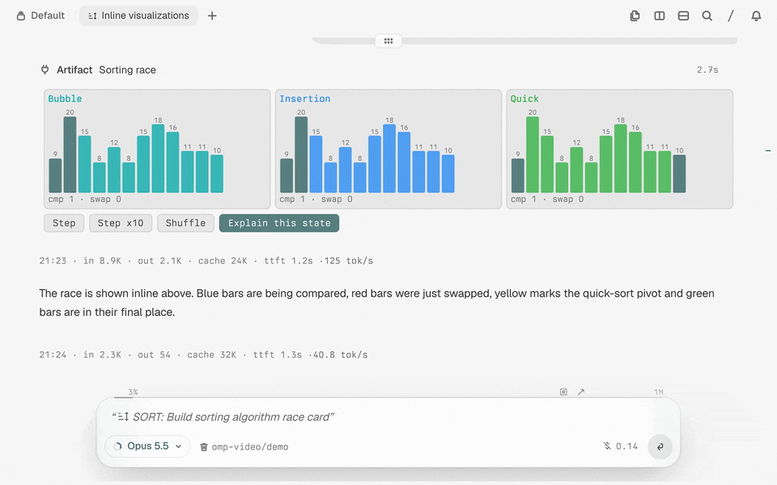

# OMP Interactive Artifacts

Interactive HTML/CSS/JavaScript pages, transcript cards, and MCP Apps for [OMP](https://github.com/can1357/oh-my-pi) in [Tern](https://github.com/stencil-hq/tern-sdk).

**Status: experimental, AI-assisted development.** Verified against OMP **18.12.1** and Tern **0.9.4**; inline rendering requires the development branch below.



Demos (inline mode, recorded in a headless Tern session with the default light theme; build and reply streaming are sped up):

- [Sorting race](docs/media/omp-inline-artifact-demo-viz.mp4): three SVG charts update on every click, then the agent explains the current state.
- [LRU cache explainer](docs/media/omp-inline-artifact-demo-lru.mp4): plain buttons, live cache state, and an agent round trip at the end.
- [Token-bucket simulator screenshot](docs/media/omp-inline-artifact-a-token-bucket.png).

## Three surfaces

- **Browser blocks:** the `artifact` tool runs a page in a Tern browser block, docked beside the agent when space allows, otherwise floating. Outside Tern (or if a protected block cannot open), it returns the saved HTML path and URL without launching a browser.
- **Inline transcript:** on a compatible OMP build, `artifact` runs the page in headless Chromium and mirrors its DOM into Tern elements. `inline_ui` offers JavaScript-free HTML cards for small forms and choices on the same build.
- **MCP Apps:** tools advertising a SEP-1865 `ui://` view open automatically in a Tern browser block; without Tern, they are not auto-opened. Views run in a sandboxed iframe on a separate loopback origin. The host proxies approved `tools/call` and exposed `resources/read` requests to the same MCP server.

The plugin also provides an `interactive-artifacts` skill. It explains when to use each surface and how to keep local interactions separate from agent requests.

## Requirements and installation

- Tern with its `tern` CLI available to OMP, for browser blocks and inline rendering.
- OMP 18.12.1 is the verified stock release. Newer releases may change the internal APIs used here.
- Bun (1.3.14 used for development and tests). OMP's standalone binary embeds Bun for plugin installation.
- **Inline pages only:** Chrome for Testing, installed by using OMP's browser tool once. The extension uses OMP's Puppeteer cache, normally `~/.omp/puppeteer/chrome/`, or `PUPPETEER_EXECUTABLE_PATH` if set to an existing executable. Named profiles use their own OMP cache. Plain `inline_ui` cards do not need Chrome.

Install from GitHub:

```sh
omp plugin install github:SJY051/omp-interactive-artifacts
```

Or develop from a local checkout:

```sh
git clone https://github.com/SJY051/omp-interactive-artifacts.git
cd omp-interactive-artifacts
bun install
omp plugin install "$PWD"
```

The local-path command links the checkout; install dependencies first. Restart OMP after installing. The manifest loads `index.ts`; OMP discovers the companion skill under `skills/` automatically.

Try asking: “Use artifact to make a small compound-interest calculator, with a number field and ± buttons.” Leave `surface` unset: stock OMP uses a browser block automatically.

Optionally add this line to your project's `AGENTS.md`:

> For simulations, calculators, explorers, or interactive choices, read the interactive-artifacts skill and use artifact or inline_ui when interaction helps more than prose.

## Enable inline rendering

Inline mode currently requires [SJY051/oh-my-pi — feat/tsp-inline-el](https://github.com/SJY051/oh-my-pi/tree/feat/tsp-inline-el), not stock OMP 18.12.1. Run the branch from source in a Tern pane:

```sh
git clone --branch feat/tsp-inline-el --single-branch https://github.com/SJY051/oh-my-pi.git oh-my-pi-tsp-inline
cd oh-my-pi-tsp-inline
bun install
bun --cwd=packages/coding-agent src/cli.ts --version
bun --cwd=packages/coding-agent src/cli.ts
```

The `--version` invocation warms the source CLI before the interactive run. If your platform needs a locally built native addon, follow that branch's native-build instructions (`bun run build:native` at the repository root). Install the plugin into the same OMP profile you run; append `--profile NAME` to both install and launch commands to isolate it.

No inline setting is required. The extension probes OMP's native element, text-input, byte-image and live Tern capabilities, then checks Chrome and the page's complexity. With `surface: "auto"`, compatible forms, tables and charts become inline cards; unsupported or heavy pages use a block. `surface: "block"` requests a full browser. Explicit `"inline"` reports a reason if unavailable. Call `artifact` directly: indirect calls through `eval` cannot produce inline cards and use a block.

## Page API

`artifact` supports `show {title, html, id?, surface?}`, `open {id, surface?}`, `close {id}`, and `list`. Reuse an `id` to update a page. `/artifact [id|list]` reopens saved pages.

| Page interface | Effect |
| --- | --- |
| `omp.send(text, data?)` | Starts an agent turn, or queues it while the agent is busy. |
| `omp.context(data)` | Updates silent context for the next user turn; the latest value wins. |
| `data-omp-send="text"` | Sends on click; optional `data-omp-data='{"key":"value"}'` supplies data. |

Filtering, sliders, charts and calculations should remain local unless the agent needs to act. For example:

```html
<p id="count">0</p>
<button onclick="document.querySelector('#count').textContent++">Add one</button>
<button data-omp-send="Explain the current result">Ask the agent</button>
```

Pages inherit theme variables such as `--fg`, `--muted`, `--surface`, `--accent`, `--c1`…`--c6` and Tern's configured fonts. The import map exposes `d3`, `chart.js/auto`, `three`, and `three/addons/controls/OrbitControls.js` from bundled local files—no CDN needed.

Artifacts persist under the active OMP agent directory at `artifacts/apps/<session>/<id>.html`, alongside previews, static inline frames and MCP audit logs. The default is `~/.omp/agent/artifacts/apps/`; named profiles keep separate artifacts. They may contain task data: do not embed credentials or unrelated personal information. Audit logs record minimized metadata (no raw app log text, URI credentials, query or fragment), are bounded per session and rotate; older logs are not retroactively redacted.

## Security model

Artifact pages are served by a token-path Bun server bound to `127.0.0.1` on a random port. CSP sandboxing blocks popups in Chromium; Tern blocks additionally restrict navigation to loopback hosts, while the headless mirror intercepts requests outside the artifact origin. No system browser is opened automatically. The returned URL, if opened manually, does not inherit Tern or mirror network controls. These are browser boundaries, not an operating-system sandbox.

MCP Apps are a distinct trust boundary: their iframe uses a separate loopback origin and a restrictive CSP, extended only by sanitized domains the MCP server declares. Such declared domains can allow network access. Same-server tools still pass through OMP's approval policy. Opening external links requires confirmation unless OMP is already in `yolo` mode.

Page-originated agent messages are labelled `[artifact … event]`, `[inline … event]`, or `[mcp app … event]`. They may be script-initiated; an artifact's page-reported gesture hint is not host-owned proof of user action. Treat their text and data as untrusted input, not instructions or authorization. A button label does not grant permission for destructive or external actions.

## Known limits

- Tern issues [#96](https://github.com/stencil-hq/tern-sdk/issues/96) and [#97](https://github.com/stencil-hq/tern-sdk/issues/97) affect inline interactions/rendering. On Tern 0.9.4, typing into an inline text/number field can scroll the transcript to the live end; keep fields and offer ± or preset buttons beside them.
- The mirror is not a pixel-perfect browser: no custom fonts, `position:fixed`, `aspect-ratio`, `text-shadow`, or `:has()`. Unsupported CSS is dropped. `select` becomes option buttons; range inputs become a bar with ± buttons; date/color inputs are read-only; `details` stays open.
- SVG and canvas become images. Canvas is a 1× PNG, polled at 4 Hz, without pointer input. JavaScript animation loops are frozen in the hidden page; CSS keyframes run in Tern. Use a browser block for WebGL/three.js, media, drag, animation-heavy pages, or browser automation.
- Images are capped at 2 MiB each (SVG: 256 KiB) and 8 MiB per card. At most six inline pages remain live; older cards become static frames. Large/deep DOMs and complex CSS also trigger automatic block selection. A hung page closes and retains its last frame.
- The MCP host does not implement every optional MCP Apps feature, including fullscreen/PiP, downloads, sampling, partial inputs or host-context change notifications.
- This plugin imports **OMP internals**, including `mcp/manager`, `mcp/client`, `tools/approval`, `config/registry`, and `@oh-my-pi/pi-tui/*`. These are not stable public contracts; an OMP update may break loading or behavior. Pin a tested OMP version and recheck before upgrading.

## Development and licensing

```sh
bun install
bun test
# After changing pinned library versions:
bun run build:vendor
bun run scripts/build-notices.ts
```

The runtime serves the committed `vendor/` bundles. Tests cover page wrapping, persistence, routing, CSP, event validation, MCP bridges and mirror logic; they do not replace verification in a real Tern pane.

MIT © 2026 SJY051. See [LICENSE](LICENSE) and [THIRD_PARTY_NOTICES.md](THIRD_PARTY_NOTICES.md) for bundled libraries and dependencies.
